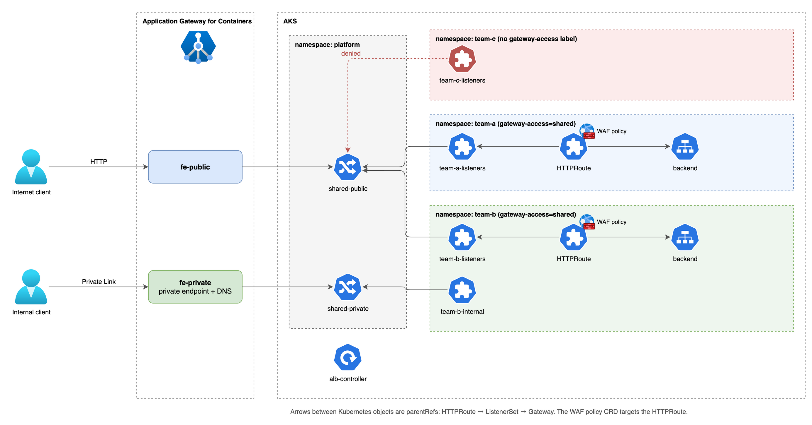

# AGC ListenerSet demo (multi-team shared gateway)

Tests Gateway API ListenerSet on Application Gateway for Containers (AGC) with OpenTofu on AKS: a platform team owns the Gateways and application teams attach their own listeners and routes from their own namespaces. Blog post: [Multi-team shared gateways on AKS with AGC and ListenerSet](https://jonas.garden/posts/agc-listenerset-multi-team/)



## What it deploys

- `infra/`: VNet, AKS (1 node, Azure CNI overlay, Free tier), ALB Controller 1.13.0 (Helm, workload identity), AGC (AzAPI, API 2026-03-01) with a public and a private frontend, private endpoint and private DNS, one WAF policy per team and one `securityPolicies` child resource per WAF policy (required for a BYO AGC).
- `manifests/`: the platform Gateways (`shared-public`, `shared-private`) with `allowedListeners` selecting namespaces labeled `gateway-access=shared`, ListenerSets and HTTPRoutes for team-a and team-b, a team-c namespace without the label, and a WAF policy per team on its own HTTPRoute.
- `scripts/test.sh`: the test scenarios below.

## Run

```
cd infra
cp ../example.tfvars terraform.tfvars   # set subscription_id
tofu init && tofu apply
az aks get-credentials -g <rg> -n <aks> --file ../kubeconfig
export KUBECONFIG=../kubeconfig
kubectl apply -f ../manifests/00-namespaces-apps.yaml
for f in 10-platform-gateways 20-team-listenersets 30-private-listenerset 40-team-c-denied; do
  sed "s#AGC_ID#$(tofu output -raw agc_id)#" ../manifests/$f.yaml | kubectl apply -f -
done
../scripts/test.sh
```

Destroy after use (`tofu destroy`). Lab test, not production guidance.

## Scenarios

1. Two teams on one frontend: `team-a.example.com` and `team-b.example.com` both answer on the public frontend.
2. A namespace without the label (team-c) cannot attach a ListenerSet.
3. A hostname conflict in team-b does not interrupt team-a.
4. Team-b exposes an internal hostname through the private Gateway.
5. Removing the namespace label withdraws that team's listeners.
6. Each team attaches its own WAF policy to its own HTTPRoute (team-a blocks `/blocked-a`, team-b blocks `/blocked-b`).

Experiments (results are in the blog post, apply them after the base setup):

- `60-experiment-waf-on-listenerset.yaml`: WAF policy targeting the ListenerSet (not listed as a supported target in the docs).
- `61-experiment-multi-listener.yaml`: several listeners in one ListenerSet.
- `62-experiment-waf-both.yaml`: WAF policy on the ListenerSet and on the HTTPRoute at the same time.
- `63-team-tls.yaml`: per-team HTTPS listeners with a certificate Secret in the team's own namespace (create the Secrets first, they are not in the repo).
- `64-experiment-waf-gateway.yaml`: platform WAF policy on the Gateway.

## Hostname policy per team

`hostname-policy/` restricts which hostnames a team may use with a ValidatingAdmissionPolicy (CEL). It only needs the Gateway API CRDs (v1.7.0 standard channel), not AGC. Apply `00-namespaces.yaml`, `10-policy.yaml` and `20-valid.yaml`, then each file in `denied/`. The recorded output is in `docs/outputs-hostname-policy.txt`.
